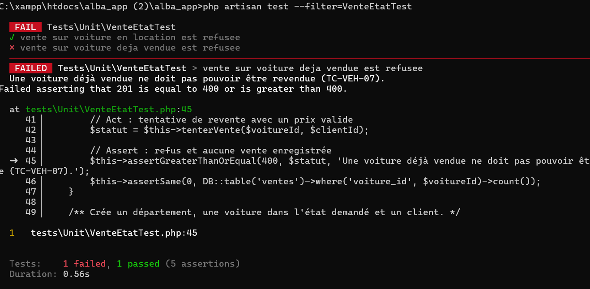
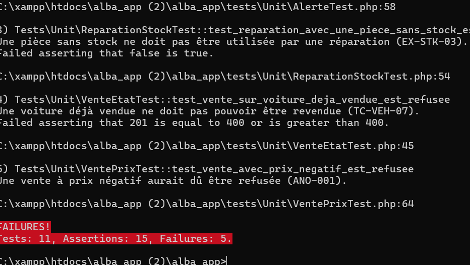

# ANO-005 : Le serveur accepte la vente d'une voiture déjà vendue

| Champ | Valeur |
|---|---|
| Identifiant | ANO-005 |
| Date de détection | 14/11/2026 |
| Détectée par | Hyba Ezzar,Emna zaydoun (test automatisé UT-04) |
| Module | Contrats > Vente (`VenteController::store`) |
| Cas de test lié | TC-VEH-07 (revendre un véhicule déjà vendu) ; transition TT-VEH-04 de la semaine 5 |
| Exigence / risque | EX-VEH-05 / R1 ; règle RG3 ; hypothèse A3 (un véhicule vendu ne peut plus être vendu) |
| Environnement | PHP 8.1.2, PHPUnit 10.5.60, Laravel 10, base de test `alba_test` |
| Statut | **Nouvelle** (non corrigée) |

## 1. Résumé

`VenteController::store` ne contrôle que l'état `location` (valeur que l'application n'écrit pas, voir ANO-007) et ne contrôle pas l'état `vendue`. Un appel direct à l'API enregistre donc une seconde vente sur une voiture déjà vendue (code HTTP 201). L'interface masque les voitures vendues dans le formulaire, ce qui cache le défaut sans le corriger.

Cette anomalie est la cause probable des deux ventes observées sur la voiture `12345-A-67` en semaine 5.

## 2. Préconditions

- Base de test `alba_test` synchronisée avec `alba_app`.
- Une voiture à l'état `vendue`, un client existant.

## 3. Étapes de reproduction

Test automatisé : `tests/Unit/VenteEtatTest.php`, méthode `test_vente_sur_voiture_deja_vendue_est_refusee`.

1. Créer une voiture à l'état `vendue` et un client dans `alba_test`.
2. Appeler `VenteController::store` avec cette voiture, ce client, un prix valide (`25000`) et une date.
3. Lire le code HTTP renvoyé.

Commande :
```
php artisan test --filter=VenteEtatTest
```

## 4. Résultat attendu

La vente est refusée (code 400 ou plus, ou erreur de validation) et aucune vente n'est enregistrée (RG3, A3).

## 5. Résultat observé

Le contrôleur renvoie le code **201** et enregistre la vente. Message du test :

```
Une voiture déjà vendue ne doit pas pouvoir être revendue (TC-VEH-07).
Failed asserting that 201 is equal to 400 or is greater than 400.
```

Le cas d'une voiture en location est lui aussi accepté (voir ANO-007) ; le test témoin d'une vente valide sur une voiture disponible réussit.

## 6. Preuves

| Fichier | Contenu |
|---|---|
| [`S6_09_tests_vente_etat.png`](../captures/S6_09_tests_vente_etat.png) | Résultat de `VenteEtatTest` : 2 échecs (en location, déjà vendue, code 201) et 1 réussite (vente valide) |
| [`S6_12_suite_complete.png`](../captures/S6_12_suite_complete.png) | Suite complète : le même échec est reproduit |
| [`S5_12_liste_vente.png`](../captures/S5_12_liste_vente.png) | Liste du formulaire Vente : l'interface ne propose pas les voitures vendues |

<p>
<a href="../captures/S6_09_tests_vente_etat.png"></a>
<a href="../captures/S6_12_suite_complete.png"></a>
</p>

## 7. Classification

| Critère | Valeur | Justification |
|---|---|---|
| Sévérité | **Critique** | Le plan (`S2`, section 11) cite la double vente d'un véhicule comme exemple de sévérité critique : règle métier essentielle violée, transaction financière en double |
| Priorité | **P1** | À corriger avant la campagne finale ; le plan (`S2`, section 12) cite « double vente possible » parmi les motifs de refus de livraison |
| Reproductibilité | 2 exécutions sur 2 | Test lancé seul, puis dans la suite complète |

## 8. Analyse et suites

- **Cause constatée** dans le code : `VenteController::store` ne compare l'état de la voiture qu'à `'location'` ; aucun test sur `'vendue'` (ni sur un état de maintenance).
- **Contournement** : aucun côté serveur. L'interface empêche le cas dans l'usage normal, mais un appel direct à l'API (Postman, script) l'enregistre.
- **À rejouer** en semaine 8 avec Postman (`POST /api/ventes` sur une voiture vendue) pour confirmer le comportement par la route réelle.
- Après correction, ce test devient un test de régression (suite minimale, risque R1 de niveau 9).
- Tant que cette anomalie est ouverte sans contournement serveur, la décision de livraison est un **refus** (`S2`, section 12).
