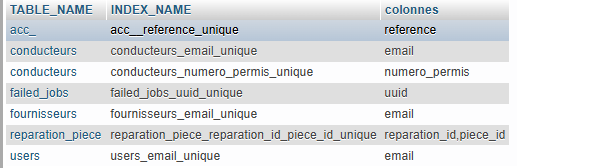
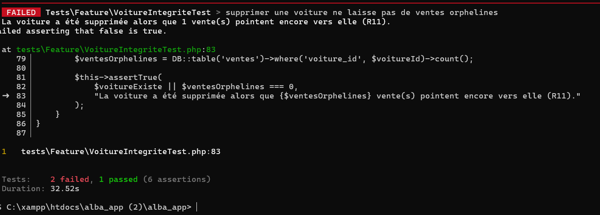

# ANO-008 : La base de données n'impose pas l'unicité du matricule

| Champ | Valeur |
|---|---|
| Identifiant | ANO-008 |
| Date de détection | 16/11/2026 |
| Détectée par | Hyba Ezzar (test d'intégration IT-03) |
| Module | Base de données, table `voitures` |
| Cas de test lié | TC-VEH-02, TC-VEH-03 |
| Exigence / risque | EX-VEH-02 (le matricule est unique) / R8 ; règle RG1 |
| Environnement | PHP 8.1.2, PHPUnit 10.5.60, Laravel 10, base de test `alba_test` |
| Statut | **Nouvelle** (non corrigée) |

## 1. Résumé

La table `voitures` n'a aucun index unique sur `matricule` (ni sur `num_serie`). L'unicité n'est garantie que par la règle de validation `unique:voitures` de `VoitureController`. Une insertion qui ne passe pas par cette validation (autre code, import de données, deux requêtes simultanées) peut créer un doublon sans que la base le refuse.

Par l'API, le doublon est bien refusé : le test IT-02 réussit (une seule voiture porte le matricule, la seconde requête est rejetée).

## 2. Préconditions

- Base de test `alba_test` synchronisée avec `alba_app`.

## 3. Étapes de reproduction

Test automatisé : `tests/Feature/VoitureIntegriteTest.php`, méthode `test_la_base_refuse_un_doublon_de_matricule`.

1. Insérer directement en base une première voiture de matricule `TEST-IT-200`.
2. Insérer une seconde voiture avec le même matricule et un autre numéro de série.

Commande :
```
php artisan test --filter=VoitureIntegriteTest
```

Contrôle complémentaire : la requête sur `information_schema.STATISTICS` (capture ci-dessous) ne liste aucun index unique pour `voitures`.

## 4. Résultat attendu

La base refuse la seconde insertion (erreur `Duplicate entry`).

## 5. Résultat observé

La seconde ligne est acceptée. Message du test :

```
La base aurait dû refuser un doublon de matricule (aucun index unique sur voitures.matricule).
```

## 6. Preuves

| Fichier | Contenu |
|---|---|
| [`S7_02_index_uniques.png`](../captures/S7_02_index_uniques.png) | Index uniques de `alba_test` : aucun sur `voitures` (ni sur `ouvriers.email`) |
| [`S7_06_tests_integrite.png`](../captures/S7_06_tests_integrite.png) | `VoitureIntegriteTest` : IT-02 réussi, IT-03 et IT-04 en échec |

<p>
<a href="../captures/S7_02_index_uniques.png"></a>
<a href="../captures/S7_06_tests_integrite.png"></a>
</p>

## 7. Classification

| Critère | Valeur | Justification |
|---|---|---|
| Sévérité | **Mineure** | Aucun doublon n'est créé par l'usage normal de l'application (la validation le refuse) ; le défaut est l'absence d'une protection de dernier recours |
| Priorité | **P3** | Peut être différée et documentée ; correction par un index unique (après nettoyage d'éventuels doublons existants) |
| Reproductibilité | 1 exécution sur 1 | Test lancé seul |

## 8. Analyse et suites

- Même absence d'index unique constatée pour `voitures.num_serie` (non testé) et pour `ouvriers.email` (voir le test IT-06).
- `VoitureController::store` renvoie un code **500** (et non 422) quand la validation échoue, parce que la validation est dans un bloc `try ... catch (\Exception)` : à vérifier en semaine 8 avec Postman (risque R13).
- Après correction, rejouer IT-03 dans la suite de régression.
