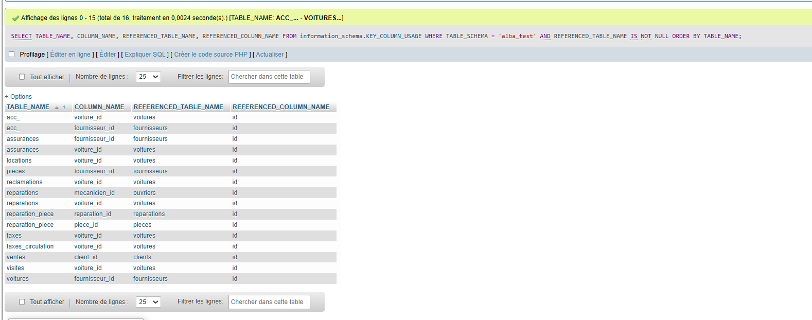
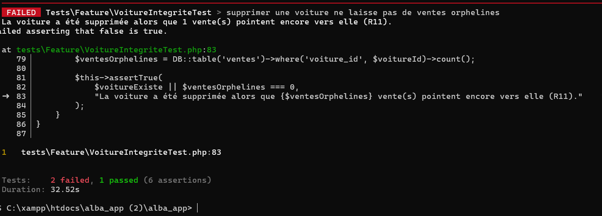

# ANO-009 : Supprimer une voiture laisse des ventes orphelines

| Champ | Valeur |
|---|---|
| Identifiant | ANO-009 |
| Date de détection | 16/11/2026 |
| Détectée par | Hyba Ezzar (test d'intégration IT-04) |
| Module | Voiture > suppression (`VoitureController::destroy`) ; table `ventes` |
| Cas de test lié | Intégrité référentielle (risque R11) |
| Exigence / risque | R11 (suppression d'un élément lié sans contrôle) ; EX-VEH-06 (historique du véhicule) |
| Environnement | PHP 8.1.2, PHPUnit 10.5.60, Laravel 10, base de test `alba_test` |
| Statut | **Nouvelle** (non corrigée) |

## 1. Résumé

Supprimer une voiture à l'état `vendue` qui a une vente supprime la voiture mais **laisse la vente**, qui pointe alors vers un identifiant inexistant. `VoitureController::destroy` ne bloque que l'état `en_location`, et la table `ventes` n'a aucune clé étrangère vers `voitures`.

À l'inverse, les assurances, taxes, visites et locations de la même voiture sont supprimées **en cascade** (clés étrangères `ON DELETE CASCADE`) : l'historique est donc conservé pour les ventes mais effacé pour les documents, de façon incohérente.

## 2. Préconditions

- Base de test `alba_test` synchronisée avec `alba_app`.
- Une voiture à l'état `vendue` et une vente qui la référence.

## 3. Étapes de reproduction

Test automatisé : `tests/Feature/VoitureIntegriteTest.php`, méthode `test_supprimer_une_voiture_ne_laisse_pas_de_ventes_orphelines`.

1. Créer une voiture à l'état `vendue`, un client et une vente pour cette voiture.
2. Envoyer `DELETE /api/voitures/{id}`.
3. Compter les ventes qui référencent encore cet identifiant.

Commande :
```
php artisan test --filter=VoitureIntegriteTest
```

## 4. Résultat attendu

La suppression est refusée, ou plus aucune vente ne référence la voiture supprimée.

## 5. Résultat observé

La voiture est supprimée et une vente la référence encore. Message du test :

```
La voiture a été supprimée alors que 1 vente(s) pointent encore vers elle (R11).
```

## 6. Preuves

| Fichier | Contenu |
|---|---|
| [`S7_01_cles_etrangeres.png`](../captures/S7_01_cles_etrangeres.png) | Clés étrangères de `alba_test` : aucune ne relie `ventes.voiture_id` à `voitures` |
| [`S7_06_tests_integrite.png`](../captures/S7_06_tests_integrite.png) | `VoitureIntegriteTest` : IT-04 en échec |

<p>
<a href="../captures/S7_01_cles_etrangeres.png"></a>
<a href="../captures/S7_06_tests_integrite.png"></a>
</p>

## 7. Classification

| Critère | Valeur | Justification |
|---|---|---|
| Sévérité | **Majeure** | Aucune valeur n'est faussée, mais des données financières (ventes) perdent leur lien avec le véhicule : historique des ventes inexploitable ; pas de perte de la vente elle-même |
| Priorité | **P2** | À corriger avant la décision de livraison |
| Reproductibilité | 1 exécution sur 1 | Test lancé seul |

## 8. Analyse et suites

- **Cause constatée** : la clé étrangère manque sur `ventes.voiture_id` (et sur les maintenances), et `destroy` ne contrôle que l'état `en_location`.
- Le comportement de suppression est à décider avec l'encadrant : interdire la suppression d'une voiture vendue, ou lui conserver ses ventes par une clé étrangère.
- Après correction, rejouer IT-04 dans la suite de régression.
