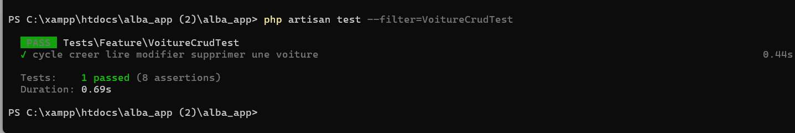
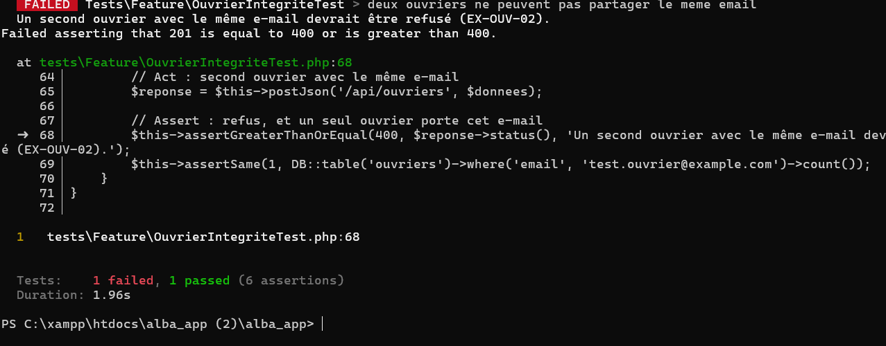

# ANO-010 : L'API est accessible sans authentification

| Champ | Valeur |
|---|---|
| Identifiant | ANO-010 |
| Date de détection | 17/11/2026 |
| Détectée par | Hyba Ezzar (tests d'intégration IT-01, IT-06, IT-07) |
| Module | API REST (`routes/api.php`) |
| Cas de test lié | TC-SEC-03 (appel de l'API sans jeton) |
| Exigence / risque | EX-SEC-02 (les pages et l'API exigent une connexion) / R5 ; règle RG9 |
| Environnement | PHP 8.1.2, PHPUnit 10.5.60, Laravel 10.50.0, base de test `alba_test` |
| Statut | **Nouvelle** (non corrigée) |

## 1. Résumé

Les routes métier de l'API ne sont pas protégées par le groupe `auth:sanctum` : un client **sans jeton ni connexion** peut créer, lire, modifier et supprimer des données. Les tests d'intégration le démontrent par exécution sur trois ressources : `voitures`, `ouvriers` et `reparations`.

## 2. Préconditions

- Base de test `alba_test` synchronisée avec `alba_app`.
- Aucun utilisateur connecté, aucun en-tête `Authorization`.

## 3. Étapes de reproduction

Tests automatisés (aucun test ne fournit de jeton) :
- `tests/Feature/VoitureCrudTest.php` : `POST`, `GET`, `PUT` et `DELETE` sur `/api/voitures` ;
- `tests/Feature/OuvrierIntegriteTest.php` : `POST` et `DELETE` sur `/api/ouvriers` ;
- `tests/Feature/ReparationStockIntegrationTest.php` : `POST` et `DELETE` sur `/api/reparations`.

Commande :
```
php artisan test --filter=VoitureCrudTest
```

## 4. Résultat attendu

Chaque appel sans jeton reçoit un code **401** et aucune donnée n'est renvoyée ni modifiée (EX-SEC-02).

## 5. Résultat observé

Les appels sans jeton réussissent : création (201), lecture (200), modification (200) et suppression (200) d'une voiture dans `VoitureCrudTest` ; création d'un ouvrier (201) dans `OuvrierIntegriteTest` ; création et suppression d'une réparation (201, 204) dans `ReparationStockIntegrationTest`.

Dans `routes/api.php`, seules `GET /user` et quelques routes sont dans le groupe `auth:sanctum` ; les ressources `users`, `voitures`, `ouvriers`, `reparations`, `ventes`, etc. sont déclarées en dehors.

## 6. Preuves

| Fichier | Contenu |
|---|---|
| [`S7_04_test_crud_voiture.png`](../captures/S7_04_test_crud_voiture.png) | `VoitureCrudTest` réussi : cycle complet sans aucun jeton |
| [`S7_07_tests_ouvriers.png`](../captures/S7_07_tests_ouvriers.png) | `OuvrierIntegriteTest` : la création d'un ouvrier renvoie 201 sans jeton |

<p>
<a href="../captures/S7_04_test_crud_voiture.png"></a>
<a href="../captures/S7_07_tests_ouvriers.png"></a>
</p>

## 7. Classification

| Critère | Valeur | Justification |
|---|---|---|
| Sévérité | **Critique** | Faille de sécurité : accès en lecture et en écriture aux données sans authentification (`S2`, section 11) |
| Priorité | **P1** | À corriger avant la campagne finale ; le plan (`S2`, section 12) cite « accès sans authentification aux données » parmi les motifs de refus de livraison |
| Reproductibilité | 3 sur 3 | Trois ressources distinctes testées |

## 8. Analyse et suites

- **Cause constatée** : la plupart des routes sont enregistrées hors du groupe `auth:sanctum` dans `routes/api.php` (un commentaire du fichier indique que `users` a été sorti du groupe protégé).
- **À vérifier en semaine 8 avec Postman** : `GET /api/users` (exposition éventuelle de comptes) et l'ensemble des routes sans en-tête `Authorization`.
- **Contournement** : aucun côté serveur ; la connexion de l'interface n'empêche pas un appel direct à l'API.
- Après correction, rejouer TC-SEC-03 et ces tests dans la suite de régression (en fournissant un jeton valide pour les cas autorisés).
- Tant que cette anomalie est ouverte, la décision de livraison est un **refus** (`S2`, section 12).
