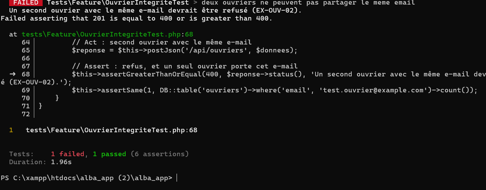
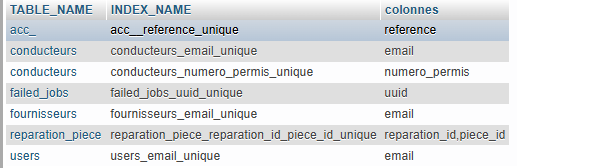

# ANO-011 : Deux ouvriers peuvent partager le même e-mail

| Champ | Valeur |
|---|---|
| Identifiant | ANO-011 |
| Date de détection | 17/11/2026 |
| Détectée par | Hyba Ezzar (test d'intégration IT-06) |
| Module | Administration > Ouvriers (`OuvrierController::store`) |
| Cas de test lié | TC-OUV-02 (ouvrier avec un e-mail déjà utilisé) |
| Exigence / risque | EX-OUV-02 (un ouvrier n'est pas dupliqué) / R8 |
| Environnement | PHP 8.1.2, PHPUnit 10.5.60, Laravel 10.50.0, base de test `alba_test` |
| Statut | **Nouvelle** (non corrigée) |

## 1. Résumé

Créer un second ouvrier avec l'e-mail d'un ouvrier existant est **accepté** (code 201). Aucune règle d'unicité n'existe ni dans la validation de `OuvrierController` (`'email' => 'nullable|email|max:255'`), ni dans la base (aucun index unique sur `ouvriers.email`).

À chaque création avec e-mail, le contrôleur génère un mot de passe et l'envoie à cette adresse : deux comptes distincts reçoivent alors leurs identifiants à la même adresse.

## 2. Préconditions

- Base de test `alba_test` synchronisée avec `alba_app` ; envoi d'e-mails simulé (`Mail::fake()`).

## 3. Étapes de reproduction

Test automatisé : `tests/Feature/OuvrierIntegriteTest.php`, méthode `test_deux_ouvriers_ne_peuvent_pas_partager_le_meme_email`.

1. Créer un ouvrier avec l'e-mail `test.ouvrier@example.com` (réponse 201).
2. Créer un second ouvrier avec le même e-mail.
3. Lire le code HTTP et compter les ouvriers portant cet e-mail.

Commande :
```
php artisan test --filter=OuvrierIntegriteTest
```

## 4. Résultat attendu

Le second ouvrier est refusé (code 400 ou plus) et un seul ouvrier porte cet e-mail (EX-OUV-02).

## 5. Résultat observé

Le second ouvrier est créé. Message du test :

```
Un second ouvrier avec le même e-mail devrait être refusé (EX-OUV-02).
Failed asserting that 201 is equal to 400 or is greater than 400.
```

## 6. Preuves

| Fichier | Contenu |
|---|---|
| [`S7_07_tests_ouvriers.png`](../captures/S7_07_tests_ouvriers.png) | `OuvrierIntegriteTest` : le test de suppression réussit, celui du doublon d'e-mail échoue (201) |
| [`S7_02_index_uniques.png`](../captures/S7_02_index_uniques.png) | Index uniques de `alba_test` : aucun sur `ouvriers.email` (il en existe pour `conducteurs`, `fournisseurs` et `users`) |

<p>
<a href="../captures/S7_07_tests_ouvriers.png"></a>
<a href="../captures/S7_02_index_uniques.png"></a>
</p>

## 7. Classification

| Critère | Valeur | Justification |
|---|---|---|
| Sévérité | **Majeure** | Doublons acceptés sans aucun garde-fou, avec envoi d'identifiants à une adresse partagée ; contournement possible (ne pas saisir deux fois la même adresse) |
| Priorité | **P2** | À corriger avant la décision de livraison |
| Reproductibilité | 1 exécution sur 1 | Test lancé seul |

## 8. Analyse et suites

- Les autres entités ont une protection (index unique pour `conducteurs.email`, `fournisseurs.email`, `users.email`) : l'absence pour `ouvriers` est une incohérence.
- Effet de bord à vérifier (non testé) : `OuvrierController::update` régénère un mot de passe et renvoie un e-mail à chaque modification d'un ouvrier qui a une adresse.
- Après correction, rejouer IT-06 dans la suite de régression.
