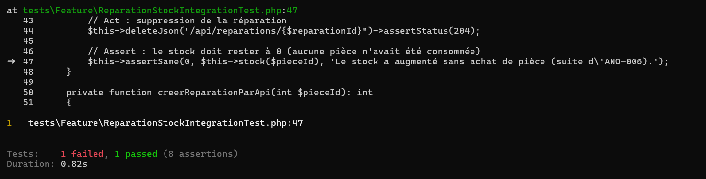
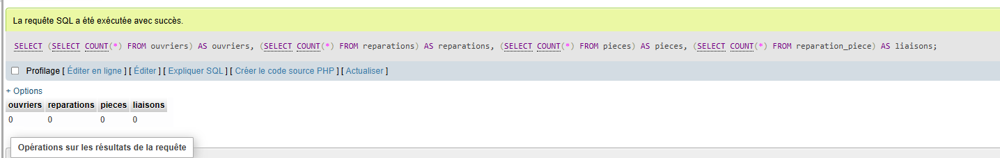

# ANO-012 : Supprimer une réparation faite sans stock augmente le stock

| Champ | Valeur |
|---|---|
| Identifiant | ANO-012 |
| Date de détection | 17/11/2026 |
| Détectée par | Hyba Ezzar (test d'intégration IT-07b) |
| Module | Paramétrage > Réparations (`ReparationController::store` et `destroy`) |
| Cas de test lié | TC-STK-03 (reformulé), suite d'ANO-006 |
| Exigence / risque | EX-STK-02, EX-STK-03 / R4 ; règle RG7 |
| Environnement | PHP 8.1.2, PHPUnit 10.5.60, Laravel 10.50.0, base de test `alba_test` |
| Statut | **Nouvelle** (non corrigée) |

## 1. Résumé

Une réparation créée avec une pièce dont le stock est à 0 est acceptée **sans décrément** (ANO-006). Quand cette réparation est ensuite supprimée, `destroy` restitue une unité à chaque pièce rattachée : le stock passe de 0 à une valeur supérieure, **sans qu'aucune pièce n'ait été achetée**.

## 2. Préconditions

- Base de test `alba_test` synchronisée avec `alba_app`.
- Une pièce dont le stock est à `0`.

## 3. Étapes de reproduction

Test automatisé : `tests/Feature/ReparationStockIntegrationTest.php`, méthode `test_supprimer_une_reparation_creee_sans_stock_ne_gonfle_pas_le_stock`.

1. Créer une pièce avec `quantite = 0`.
2. Créer une réparation qui l'utilise (`POST /api/reparations`) : acceptée, stock toujours à 0.
3. Supprimer la réparation (`DELETE /api/reparations/{id}`, code 204).
4. Relire le stock de la pièce.

Commande :
```
php artisan test --filter=ReparationStockIntegrationTest
```

## 4. Résultat attendu

Le stock reste à 0 : aucune pièce n'avait été consommée, donc aucune ne doit être restituée.

## 5. Résultat observé

Le stock n'est plus à 0 après la suppression : l'assertion de la ligne 47 du test échoue avec le message :

```
Le stock a augmenté sans achat de pièce (suite d'ANO-006).
```

La valeur exacte lue n'apparaît pas sur la capture ; d'après le code (`increment('quantite', quantite_utilisee)` avec `quantite_utilisee = 1`), elle est de 1.

Le test témoin IT-07a réussit : avec un stock de 25, la création fait passer le stock à 24 et la suppression le remet à 25.

## 6. Preuves

| Fichier | Contenu |
|---|---|
| [`S7_08_tests_stock_integration.png`](../captures/S7_08_tests_stock_integration.png) | `ReparationStockIntegrationTest` : IT-07a réussi, IT-07b en échec (ligne 47) |
| [`S7_10_proprete_ouvriers_stock.png`](../captures/S7_10_proprete_ouvriers_stock.png) | Après les tests : `pieces`, `reparations` et `reparation_piece` à 0 |

<p>
<a href="../captures/S7_08_tests_stock_integration.png"></a>
<a href="../captures/S7_10_proprete_ouvriers_stock.png"></a>
</p>

## 7. Classification

| Critère | Valeur | Justification |
|---|---|---|
| Sévérité | **Majeure** | Le stock devient faux (supérieur à la réalité), ce qui peut masquer une rupture et fausser les achats ; pas de donnée financière directe |
| Priorité | **P2** | À corriger avant la décision de livraison, avec ANO-006 (même cause) |
| Reproductibilité | 1 exécution sur 1 | Test lancé seul |

## 8. Analyse et suites

- **Cause constatée** : `store` ne décrémente que si `quantite > 0` mais rattache la pièce dans tous les cas ; `destroy` restitue ensuite `quantite_utilisee` sans savoir si la pièce avait été décrémentée.
- **À vérifier** (non testé) : `update` suit la même logique et remet `+1` pour chaque ancienne pièce.
- Corriger ANO-006 (refuser ou ne pas rattacher la pièce sans stock) supprime aussi cette anomalie ; rejouer IT-07b ensuite.
