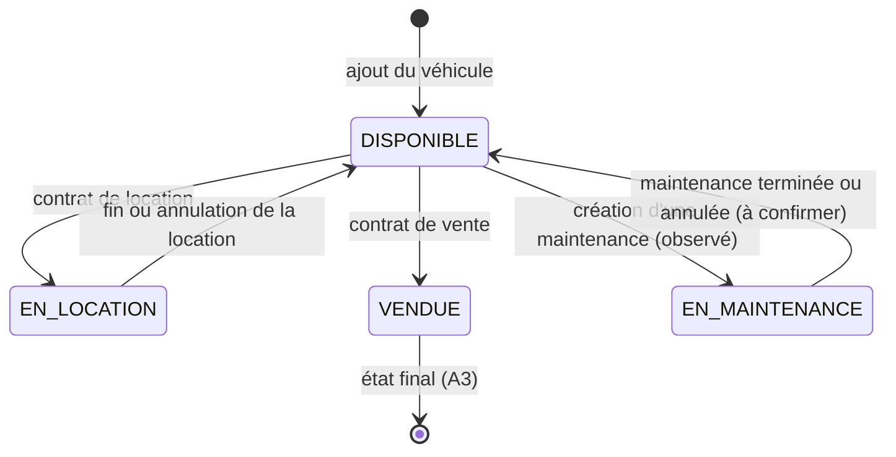

# Transitions d'état et tests exploratoires : Park Manager

| Élément | Valeur |
|---|---|
| Version | 1.0 (semaine 5 terminée) |
| Date | 13/11/2026 |
| Auteure | emna zaydoun et Hyba Ezzar |
| Documents liés | `S3_exigences_tracabilite.md`, `S4_cas_de_test.md` |

## 1. Écarts avec le référentiel du sujet

Le sujet s'appuie sur le cycle d'une réclamation. Dans Park Manager, aucune page ne permet de gérer les réclamations. Le cycle de vie testé est donc celui de la **voiture**, qui est au cœur du risque R1.

| Référentiel du sujet | Application réelle | Conséquence |
|---|---|---|
| Cycle NOUVELLE → EN_COURS → RESOLUE → CLOTUREE | Pas de page réclamations ; cycle voiture à la place | Cycle voiture testé |
| Rôles client, agent, administrateur | Seul le rôle `admin` est utilisé | Test « un client ne voit que ses données » **non applicable** |
| Statut contraint par une énumération | `voitures.etat` est un `varchar` sans contrainte | Aucune protection en base : tout contrôle repose sur le code |
| RG2 (`S2`) : statuts DISPONIBLE, EN LOCATION, VENDU | Un quatrième état, **EN MAINTENANCE**, existe | RG2 à corriger dans le plan de test |
| `S1` : composants de réclamation à vérifier | Aucun menu Réclamations dans l'interface actuelle ; les routes API `reclamations` existent | Hors périmètre interface ; routes à tester en semaine 8 |

## 2. Diagramme d'états de la voiture

L'état `EN_MAINTENANCE` est confirmé (capture du catalogue après création d'une maintenance). Le retour à DISPONIBLE après **Terminer** est confirmé (section 5).

## 3. Table des transitions

| ID | État de départ | Action | État attendu | Verdict attendu |
|---|---|---|---|---|
| TT-VEH-01 | DISPONIBLE | Créer une location | EN_LOCATION | Autorisée |
| TT-VEH-02 | EN_LOCATION | Fin de la location (automatique : aucun bouton dans l'interface) | DISPONIBLE | Autorisée |
| TT-VEH-03 | DISPONIBLE | Créer une vente | VENDUE | Autorisée (= TC-CTR-06) |
| TT-VEH-04 | VENDUE | Créer une vente | VENDUE, une seule vente | **Interdite** (= TC-VEH-07) |
| TT-VEH-05 | VENDUE | Créer une location | VENDUE inchangé | **Interdite** (= TC-VEH-08) |
| TT-VEH-06 | VENDUE | Créer une maintenance | VENDUE inchangé | **Interdite** |
| TT-VEH-07 | EN_LOCATION | Créer une vente | EN_LOCATION inchangé | **Interdite** (hypothèse de la table de décision) |
| TT-VEH-08 | EN_LOCATION | Créer une maintenance | EN_LOCATION inchangé | **Interdite** |
| TT-VEH-09 | DISPONIBLE | Créer une maintenance, puis la terminer | EN_MAINTENANCE puis DISPONIBLE | Autorisée |
| TT-VEH-10 | EN_LOCATION | Créer une seconde location sur la même voiture | EN_LOCATION inchangé, une seule location active | **Interdite** (R1) |

Les cas TT-VEH-04 et 05 reprennent des cas de la semaine 4 : on les exécute une seule fois et on réutilise le résultat.

## 4. Observations préalables (non encore des anomalies)

Ces points viennent de captures d'écran. Ils deviendront des anomalies seulement après une exécution reproductible (étape 5.4).

| Observation | Cas concerné |
|---|---|
| La voiture 12345-A-67, état VENDUE, a deux ventes enregistrées (18/02 et 28/02/2026), alors que l'interface actuelle n'offre pas les voitures vendues dans le formulaire de vente. Origine à élucider : données anciennes ou appel direct à l'API (la piste « liste non rafraîchie » est écartée) ; à vérifier avec Postman en semaine 8 | TT-VEH-04 / TC-VEH-07 |
| Une vente à 56 465 464 DT est enregistrée | TC-CTR-05 |
| Cette voiture vendue génère des alertes « Urgent » | TC-ALR-04 |
| La voiture `2222222` est passée de DISPONIBLE à EN LOCATION après un contrat | TT-VEH-01 (conforme à l'attendu) |
| La voiture `q` est passée à EN MAINTENANCE à la création de la maintenance | TT-VEH-09 (conforme à l'attendu) |
| Le bouton **Désactiver** affiche « Erreur lors de la désactivation de la voiture » | **ANO-002** : la console montre `PUT ... 404 (Not Found)` (`GestionVoitures.jsx:259`) |
| Le formulaire Achat accepte la marque « Renault » avec le modèle « Peugeot 208 » (`90001-T-01`) | TC-VEH-01 ; incohérence de données, sévérité faible |
| Le formulaire Achat accepte une date d'achat dans le futur (21/11/2026, à confirmer d'après l'ordre des champs) | Règle de gestion à préciser (A4) |
| La vente de `90001-T-01` est datée du 13/11/2026, avant sa date d'achat (21/11/2026) | Incohérence de dates, à reproduire |
| Un prix de vente de 5 856 449 846 894 et un prix d'achat de 1 555 555 565 sont acceptés | TC-CTR-05 (borne haute non définie) |
| La fiche de `5555` affiche la date de la location au format brut `2026-11-29T00:00:00.000000Z` (même défaut que la maintenance) | Défaut d'affichage récurrent, sévérité cosmétique ou mineure |
| Une location à 64 646 464 DT est acceptée | Pas de borne haute sur les montants (A4) |
| Une location commençant le 29/11/2026 met la voiture EN LOCATION dès le 13/11/2026 | Hypothèse **A11** : l'état semble dépendre de la date de fin (EN LOCATION tant que la fin n'est pas passée, même si le début est futur), comparaison `5555` / `q` ; à confirmer avec l'encadrant |
| La page Alertes contient deux lignes identiques « Assurance a expiré le 21/02/2026 » pour `12345-A-67` | Expliqué : deux assurances distinctes (id 4 et 5 de `assurances`, voir section 5) |
| Les 11 alertes affichées concernent toutes `12345-A-67`, voiture VENDUE | Alertes maintenues pour un véhicule vendu (A5 / R3) ; à confirmer avec un nouveau document (TC-ALR-04) |
| Requête sur `expiration_alerts` pour le 21/02/2026 : aucune ligne, alors que la page affiche des alertes à cette date | Les alertes sont calculées à partir des documents (confirmé : les deux lignes viennent de deux enregistrements de `assurances`) |
| L'alerte pour une assurance expirant le 14/11/2026 affiche « Aujourd'hui » alors que la date du jour est le 13/11/2026 | Confirmé par un second essai (16/11 affiché « Dans 2 jour(s) ») : **ANO-004** |
| Deux assurances « tous risques » de `voiture_id` 1 se chevauchent (début 04/02 et 19/02/2026, même expiration 21/02/2026) et sont acceptées ; la page Alertes affiche deux lignes identiques | Nouvelle hypothèse **A12** : deux assurances de même type peuvent-elles se chevaucher ? (R8) |
| La date de début de la maintenance s'affiche au format brut `2026-11-13T19:22:33.000000Z` | Défaut d'affichage probable, sévérité faible |

## 5. Résultats d'exécution (étape 5.2)

Environnement : application locale `localhost:3001`, rôle admin, données existantes (voitures non préfixées `TEST`).

| ID | Date | Résultat observé | Verdict | Preuve |
|---|---|---|---|---|
| TT-VEH-09 | 13/11/2026 | Création d'une maintenance sur `q` : état EN MAINTENANCE. Clic sur Terminer : message « Maintenance terminée ! La voiture est maintenant disponible. », état DISPONIBLE dans le catalogue et sur la fiche | **Réussi** | [message](../captures/S5_10_maintenance_terminee_a.png), [catalogue](../captures/S5_10_maintenance_terminee_b.png), [fiche](../captures/S5_10_maintenance_terminee_c.png) |
| TT-VEH-01 | 13/11/2026 | `2222222` observée EN LOCATION après un contrat | **Réussi** (retour à DISPONIBLE non testé) | Pas de capture dédiée (voir le complément ci-dessous) |
| TT-VEH-04 | 13/11/2026 | La liste « Choisir voiture » du formulaire Vente ne contient aucune voiture VENDUE | **Réussi au niveau interface** ; niveau API non testé | [liste Vente](../captures/S5_12_liste_vente.png) |
| TT-VEH-05 | 13/11/2026 | La liste des voitures du formulaire Location ne contient aucune voiture VENDUE | **Réussi au niveau interface** ; niveau API non testé | [liste Location](../captures/S5_13_liste_location.png) |
| TT-VEH-07 | 13/11/2026 | `2222222` (EN LOCATION) absente de la liste du formulaire Vente | **Réussi au niveau interface** ; niveau API non testé | [liste Vente](../captures/S5_12_liste_vente.png) |
| TT-VEH-03 / TC-CTR-06 | 13/11/2026 | Vente de `90001-T-01` (DISPONIBLE) au client `Test Client`, prix 5 856 449 846 894 : l'état passe à VENDUE dans le catalogue | **Réussi** | [formulaire Vente](../captures/S5_17_achat_vente_90001_c.png), [catalogue VENDUE](../captures/S5_17_achat_vente_90001_d.png) |
| TC-VEH-01 | 13/11/2026 | Création de `90001-T-01` par **Contrats > ACHAT** (et non par la page Voiture) : la voiture apparaît DISPONIBLE | **Réussi**, avec valeurs incohérentes acceptées (voir section 4) | [formulaire Achat](../captures/S5_17_achat_vente_90001_a.png), [catalogue](../captures/S5_17_achat_vente_90001_b.png) |
| TT-VEH-04 (complément) | 13/11/2026 | Juste après la vente de `90001-T-01`, la liste « Choisir voiture » du formulaire Vente ne la propose plus. L'hypothèse « liste non rafraîchie » n'est pas confirmée | **Réussi** ; rechargement de la page avant la capture à confirmer | [liste Vente](../captures/S5_12_liste_vente.png) |
| TC-CTR-03 (partiel) | 13/11/2026 | Vente de `90004-T-04` avec un prix de **-5555** et une date de vente du 06/11/2026 : message « Vente enregistrée » ; la fiche affiche VENDUE et une vente à -5555.00 DT | **ÉCHEC** (refus attendu, A4) ; prix `0` et `-1` non testés | [message](../captures/S5_01_vente_prix_negatif.png), [fiche](../captures/S5_02_fiche_vente_negative.png) ; [ANO-001](../04-anomalies/ANO-001_prix_vente_negatif.md) |
| Exploratoire : prix vide | 13/11/2026 | Prix vide : bulle du navigateur « Veuillez renseigner ce champ » | Refus côté navigateur ; contrôle serveur non testé | Pas de capture dédiée |
| Exploratoire : dates de location | 13/11/2026 | Location de `5555` avec début 30/10/2026 et fin 28/10/2026 : message « La date de fin doit être supérieure ou égale à la date de location » | **Réussi** (refus côté interface) ; contrôle serveur non testé | Pas de capture dédiée |
| TT-VEH-01 (complément) | 13/11/2026 | Location de `5555` du 29/11 au 30/11/2026 (dates futures) : « 1 location(s) enregistrée(s) avec succès ! ». Le jour même, la fiche affiche EN LOCATION | **Réussi** pour la transition ; état pris **avant** la date de début (à confirmer, hypothèse A11) | [message](../captures/S5_15_location_dates_futures_a.png), [fiche](../captures/S5_15_location_dates_futures_b.png) |
| TT-VEH-02 | 13/11/2026 | Location de `q` du 04/11 au 05/11/2026 (dates passées) acceptée ; la fiche affiche DISPONIBLE et deux locations dans l'historique | **Réussi** (état final conforme) ; mécanisme de fin non établi | [formulaire](../captures/S5_16_location_dates_passees_a.png), [fiche](../captures/S5_16_location_dates_passees_b.png) |
| TT-VEH-10 | 13/11/2026 | `5555` (EN LOCATION) n'apparaît plus dans la liste des voitures du formulaire Location | **Réussi au niveau interface** ; niveau API non testé | [liste Location sans 5555](../captures/S5_14_liste_location_sans_5555.png) |
| TC-ALR-03 (exploratoire) | 13/11/2026 | Page Alertes actualisée plusieurs fois : 11 alertes avant et après | **Réussi** (aucune alerte ajoutée à l'actualisation) | [page Alertes](../captures/S5_08_alertes_temps_restant.png) |
| TC-ALR-04 | 13/11/2026 | Assurance ajoutée à `90004-T-04` (VENDUE), expirant le 14/11/2026 : une alerte « Urgent » apparaît pour cette voiture | **ÉCHEC** (aucune alerte attendue, A5) | [formulaire](../captures/S5_06_assurance_vehicule_vendu.png), [page Alertes](../captures/S5_07_alerte_vehicule_vendu.png) ; [ANO-003](../04-anomalies/ANO-003_alerte_vehicule_vendu.md) |
| TC-ALR-03 (complément) | 13/11/2026 | Les deux lignes identiques du 21/02/2026 proviennent de deux assurances distinctes (id 4 et 5) : une alerte par document | **Réussi** | [requête alertes](../captures/S5_18_requetes_phpmyadmin_a.png), [requête assurances](../captures/S5_18_requetes_phpmyadmin_b.png) |
| TC-ALR-01 (partiel) | 13/11/2026 | Échéance du 14/11 affichée « Aujourd'hui » (1 jour réel) ; échéance du 16/11 affichée « Dans 2 jour(s) » (3 jours réels) ; poste daté du 13/11/2026 | **ÉCHEC** sur le temps restant ; seuil de 30 jours non testé | [page Alertes](../captures/S5_08_alertes_temps_restant.png), [horloge](../captures/S5_09_heure_poste.png) ; [ANO-004](../04-anomalies/ANO-004_temps_restant_alerte_decale.md) |
| TT-VEH-06 | 13/11/2026 | La liste « Voitures Disponibles » de la page Maintenance ne contient aucune voiture VENDUE (`12345-A-67`, `123`, `11111111111`) | **Réussi au niveau interface** ; niveau API non testé | [liste Maintenance](../captures/S5_11_liste_maintenance.png) |
| TT-VEH-08 | 13/11/2026 | La même liste ne contient pas `2222222` (EN LOCATION) | **Réussi au niveau interface** ; niveau API non testé | [liste Maintenance](../captures/S5_11_liste_maintenance.png) |

Limite : le blocage vérifié est celui de l'interface. La route `POST maintenances` n'est pas dans le groupe `auth:sanctum` de `routes/api.php` ; la vérification côté serveur sera faite avec Postman (semaine 8).

Remarque : la fiche de `q` affiche la maintenance terminée sous « Maintenances Préventives » avec un coût de 4,65 DT et « Aucune description ». Le coût saisi à la création doit être comparé à cette valeur.

## 6. Avancement

| Étape | Contenu | Statut |
|---|---|---|
| 5.1 | Diagramme d'états de la voiture | Fait |
| 5.2 | Exécuter les transitions TT-VEH-01 à 10 et noter les résultats observés | **Fait** au niveau interface ; niveau API en semaine 8 |
| 5.3 | Session exploratoire (3 missions : formulaire Vente, bouton Désactiver, alertes) | **Fait** |
| 5.4 | Fiches d'anomalie et registre (ANO-001 à ANO-004, `registre_anomalies.md`) | **Fait** |
## 8. Bilan de la semaine 5

### 8.1 Transitions

| Catégorie | Cas | Résultat |
|---|---|---|
| Transitions autorisées | TT-VEH-01, 02, 03, 09 | 4 sur 4 réussies |
| Transitions interdites | TT-VEH-04, 05, 06, 07, 08, 10 | 6 sur 6 bloquées **par l'interface** ; niveau API non testé |

### 8.2 Cas du catalogue S4 touchés cette semaine

| Cas | Résultat |
|---|---|
| TC-VEH-01 | Réussi (création par Contrats > ACHAT) |
| TC-VEH-07, TC-VEH-08 | Réussis au niveau interface |
| TC-CTR-01 | Réussi (vente enregistrée, voiture VENDUE ; historique non capturé) |
| TC-CTR-06 | Réussi |
| TC-CTR-03 | **Échec** partiel : prix -5555 accepté ; `0` et `-1` non testés (ANO-001) |
| TC-ALR-01 | **Échec** partiel : temps restant décalé ; seuil de 30 jours non testé (ANO-004) |
| TC-ALR-03 | Réussi |
| TC-ALR-04 | **Échec** (ANO-003) |
| TC-VEH-10 | **Échec** (ANO-002) |
| TC-VEH-02, 03, 06 ; TC-CTR-02 ; TC-DOC-03 | **Non exécutés** : à rejouer dans la campagne finale |

### 8.3 Anomalies

Quatre anomalies, détaillées dans `registre_anomalies.md` : 1 critique (ANO-001), 2 majeures (ANO-002, ANO-003), 1 mineure (ANO-004).

### 8.4 Limites des tests

- Exécution manuelle uniquement, avec le rôle administrateur (un seul rôle utilisé).
- Résultats obtenus au niveau de l'interface : le serveur n'a pas été interrogé directement (semaine 8).
- Une partie des tests a été faite sur des données existantes, non préfixées `TEST`.
- La session exploratoire s'est faite en trois missions, sans chronométrage.
- Plusieurs anomalies reposent sur une seule série d'essais, ou sur une hypothèse à confirmer (A5, A11, A12).

