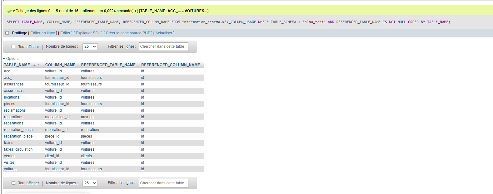
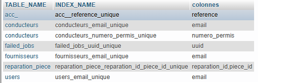
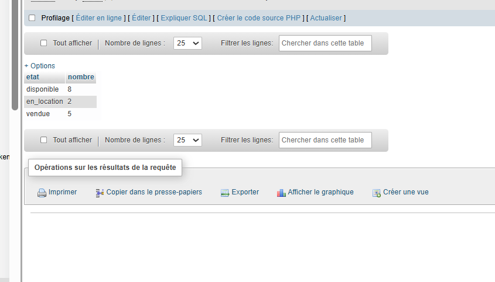
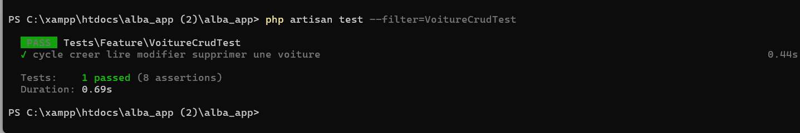
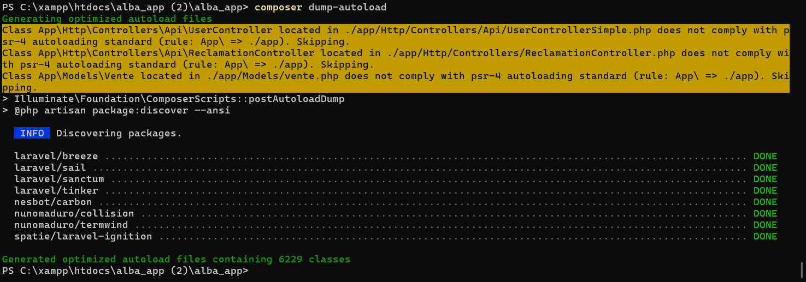
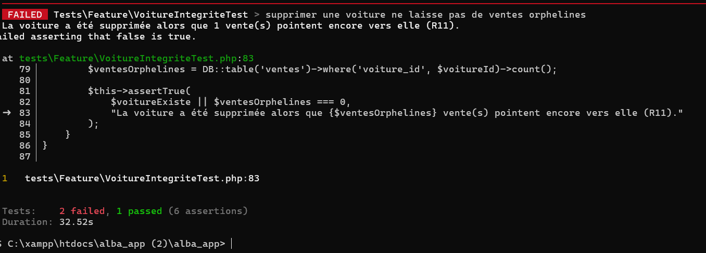
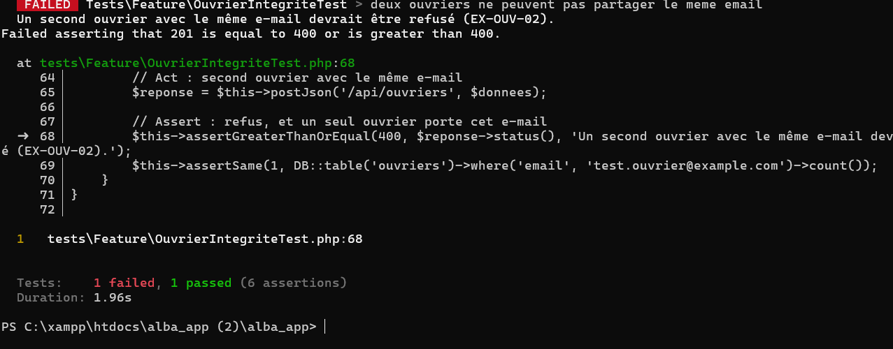
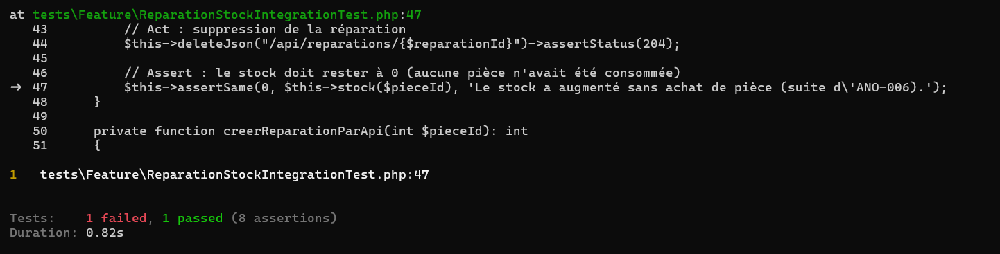
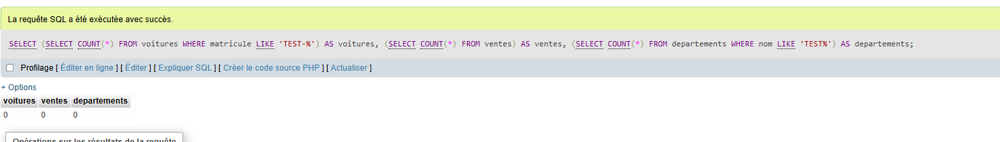
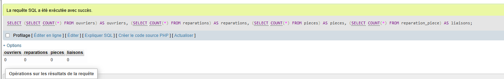

# Tests d'intégration et base de données : Park Manager

| Élément | Valeur |
|---|---|
| Version | 1.0 (semaine 7) |
| Date | 17/11/2026 |
| Auteure | Hyba Ezzar,Emna zaydoun |
| Documents liés | `S4_cas_de_test.md`, `S6_tests_unitaires.md`, `registre_anomalies.md`, `S2_plan_de_test.md` (sections 4 et 10) |

## 1. Objet et méthode

Ce rapport présente les tests d'intégration écrits et **exécutés** en semaine 7 : opérations CRUD, persistance, contraintes d'intégrité et cas d'échec, vérifiés dans la base de données.

| | Semaine 6 : tests unitaires | Semaine 7 : tests d'intégration |
|---|---|---|
| Dossier | `tests/Unit/` | `tests/Feature/` |
| Cible | Méthode d'un contrôleur, appelée directement | Route HTTP, contrôleur et base de données ensemble |
| Vérification | Réponse ou règle (refus, code, valeur) | **État de la base** : ligne créée, supprimée, lignes orphelines |

| Principe | Mise en œuvre |
|---|---|
| Appels | Vraies routes de l'API (`/api/voitures`, `/api/ouvriers`, `/api/reparations`) avec `postJson`, `getJson`, `putJson`, `deleteJson` |
| Base de données | Base séparée `alba_test` (forcée dans `phpunit.xml`), jamais `alba_app` |
| Isolation | `DatabaseTransactions` : toutes les écritures d'un test sont annulées à sa fin |
| Données reproductibles | Outil `tests/Support/DonneesDeTest.php` : départements, voitures, clients, pièces, ouvriers, tous préfixés `TEST` |
| Assertions | `assertStatus`, `assertDatabaseHas`, `assertDatabaseMissing`, `assertSame`, `assertTrue`, `assertNotSame`, `assertGreaterThanOrEqual` |
| Double de test | `Mail::fake()` : aucun e-mail réel n'est envoyé lors de la création d'un ouvrier |

## 2. Environnement et incidents

| Élément | Valeur |
|---|---|
| PHP | 8.1.2 (ZTS, 64 bits) |
| PHPUnit | 10.5.60 |
| Framework | Laravel 10.50.0 |
| Base de données | MariaDB 10.4.22 (XAMPP), base de test `alba_test` |

### Incident : arrêt de MySQL

| Étape | Constat |
|---|---|
| Symptôme | Les tests attendent plus de 5 minutes puis échouent avec `SQLSTATE[HY000] [2002]` (connexion refusée) ; phpMyAdmin reste sur une page blanche |
| Diagnostic 1 | `netstat` : MySQL écoute sur le port 3306 ; `mysqladmin` échoue au handshake (`reading initial communication packet`) : le serveur ne termine pas son démarrage |
| Diagnostic 2 | Le journal ne contient jamais `ready for connections` ; `mysqld.exe --console` affiche `Table '.\mysql\db' is marked as crashed and last (automatic?) repair failed`, puis `Aborting` |
| Précaution | Copie complète du dossier `data` (368 fichiers, avec `alba_app` et `alba_test`) avant toute réparation ; aucune réinstallation |
| Réparation | `aria_chk -c db` : table corrompue (erreur 176, 2 clés sur 5) ; `aria_chk -r db` : reconstruction, 2 enregistrements conservés ; `aria_chk -c db` : aucune erreur ; vérification de toutes les tables système puis redémarrage |
| Cause probable | Arrêt non propre de XAMPP (la même famille que l'erreur « wrong checksum » de la semaine 6) ; la présence d'un fichier de sauvegarde datant de novembre 2025 indique une réparation antérieure. Hypothèse non démontrée |
| Enseignement | Arrêter MySQL par le bouton Stop, sauvegarder avant de réparer, lire le journal avant d'agir. Les bases `alba_app` et `alba_test` n'étaient pas concernées : seule une table système de droits l'était |

Les sorties de la console de MySQL et d'`aria_chk` ne sont pas jointes en capture ; le journal d'origine est `C:\xampp\mysql\data\mysql_error.log` (non versionné).

## 3. Inventaire des contraintes de la base

Requêtes lues dans `information_schema` de la base `alba_test`.

### Clés étrangères (16)

| Table | Colonne | Référence |
|---|---|---|
| `acc_` | `voiture_id`, `fournisseur_id` | `voitures`, `fournisseurs` |
| `assurances` | `voiture_id`, `fournisseur_id` | `voitures`, `fournisseurs` |
| `locations`, `reclamations`, `taxes`, `taxes_circulation`, `visites` | `voiture_id` | `voitures` |
| `pieces` | `fournisseur_id` | `fournisseurs` |
| `reparations` | `voiture_id`, `mecanicien_id` | `voitures`, `ouvriers` |
| `reparation_piece` | `reparation_id`, `piece_id` | `reparations`, `pieces` |
| `ventes` | `client_id` | `clients` |
| `voitures` | `fournisseur_id` | `fournisseurs` |

### Index uniques (7)

`acc_.reference`, `conducteurs.email`, `conducteurs.numero_permis`, `failed_jobs.uuid`, `fournisseurs.email`, `reparation_piece (reparation_id, piece_id)`, `users.email`.

### Constats

| Constat | Conséquence | Test |
|---|---|---|
| Aucun index unique sur `voitures.matricule` ni `voitures.num_serie` | L'unicité repose uniquement sur la validation de `VoitureController` | IT-02, IT-03 (ANO-008) |
| Aucun index unique sur `ouvriers.email` | Doublons possibles | IT-06 (ANO-011) |
| Aucune clé étrangère de `ventes` vers `voitures` (ni sur `maintenances`) | Ventes orphelines possibles | IT-04 (ANO-009) |
| `reparations.mecanicien_id` référence `ouvriers` | Voir IT-05 | IT-05 |

Les règles de suppression (`ON DELETE CASCADE` pour les assurances, taxes, visites et locations d'une voiture ; `ON DELETE SET NULL` pour le mécanicien d'une réparation) sont lues dans l'ancien dump `alba_app.sql` : la requête de la capture ne les affiche pas.

Preuves : [`S7_01`](../captures/S7_01_cles_etrangeres.png), [`S7_02`](../captures/S7_02_index_uniques.png).

## 4. États réels des voitures

| État dans `alba_app` | Nombre |
|---|---|
| `disponible` | 8 |
| `en_location` | 2 |
| `vendue` | 5 |

La base écrit `en_location`, alors que `VenteController` compare à `location` : voir ANO-007 et `S6_tests_unitaires.md`. Preuve : [`S7_03`](../captures/S7_03_etats_alba_app.png).

## 5. Tests écrits

Quatre fichiers dans `tests/Feature/`, huit tests (le sujet en demande au moins trois).

| ID | Fichier et méthode | Cas S4 / exigence | Risque | Résultat | Anomalie |
|---|---|---|---|---|---|
| IT-01 | `VoitureCrudTest` : créer, lire, modifier, supprimer une voiture | TC-VEH-01 / EX-VEH-01 | R8 | **Réussi** | ANO-010 (sans jeton) |
| IT-02 | `VoitureIntegriteTest` : doublon de matricule envoyé à l'API refusé, base inchangée | TC-VEH-02, 03 / EX-VEH-02 | R8 | **Réussi** | |
| IT-03 | `VoitureIntegriteTest` : la base refuse un doublon de matricule | TC-VEH-02, 03 / EX-VEH-02 | R8 | **Échec** | ANO-008 |
| IT-04 | `VoitureIntegriteTest` : supprimer une voiture ne laisse pas de ventes orphelines | R11 | R11 | **Échec** | ANO-009 |
| IT-05 | `OuvrierIntegriteTest` : supprimer un ouvrier lié à une réparation conserve l'historique | TC-OUV-03 / EX-OUV-03 | R11 | **Réussi** | |
| IT-06 | `OuvrierIntegriteTest` : deux ouvriers ne partagent pas le même e-mail | TC-OUV-02 / EX-OUV-02 | R8 | **Échec** | ANO-011 |
| IT-07a | `ReparationStockIntegrationTest` : supprimer une réparation restitue le stock utilisé | TC-STK-02 / EX-STK-02 | R4 | **Réussi** | |
| IT-07b | `ReparationStockIntegrationTest` : réparation créée sans stock puis supprimée, stock inchangé | TC-STK-03 / EX-STK-03 | R4 | **Échec** | ANO-012 |

TC-VEH-07 (revente d'une voiture vendue) a été automatisé en semaine 6 (UT-04, ANO-005) ; en semaine 7, les tests vérifient l'état de la base.

Un test qui échoue parce qu'il a trouvé une vraie anomalie est un résultat valide. Aucun code de l'application n'a été modifié pour faire passer un test.

## 6. Résultats d'exécution

| Fichier de test | Résultat | Assertions | Durée |
|---|---|---|---|
| `VoitureCrudTest` | 1 réussi | 8 | 0,69 s |
| `VoitureIntegriteTest` | 1 réussi, 2 échoués | 6 | 32,52 s |
| `OuvrierIntegriteTest` | 1 réussi, 1 échoué | 6 | 1,96 s |
| `ReparationStockIntegrationTest` | 1 réussi, 1 échoué | 8 | 0,82 s |
| **Total** | **4 réussis, 4 échoués (8 tests)** | **28** | |

La durée de 32,52 s est celle du premier lancement après le redémarrage de MySQL (connexion à froid).

### Messages d'échec retenus

| Test | Message observé |
|---|---|
| IT-03 | `La base aurait dû refuser un doublon de matricule (aucun index unique sur voitures.matricule).` |
| IT-04 | `La voiture a été supprimée alors que 1 vente(s) pointent encore vers elle (R11).` |
| IT-06 | `Failed asserting that 201 is equal to 400 or is greater than 400.` |
| IT-07b | Assertion de la ligne 47 : `Le stock a augmenté sans achat de pièce (suite d'ANO-006).` |

### Propreté de la base

Après les tests, `voitures` (préfixe `TEST`), `ventes`, `departements` (préfixe `TEST`), `ouvriers`, `reparations`, `pieces` et `reparation_piece` de `alba_test` sont à **0** : les transactions annulent bien les écritures.

Preuves : [`S7_04`](../captures/S7_04_test_crud_voiture.png), [`S7_06`](../captures/S7_06_tests_integrite.png), [`S7_07`](../captures/S7_07_tests_ouvriers.png), [`S7_08`](../captures/S7_08_tests_stock_integration.png), [`S7_09`](../captures/S7_09_proprete_integrite.png), [`S7_10`](../captures/S7_10_proprete_ouvriers_stock.png).

## 7. Anomalies et constats

| Anomalie | Sévérité | Priorité | Test | Cause constatée |
|---|---|---|---|---|
| ANO-010 L'API est accessible sans authentification | Critique | P1 | IT-01, IT-06, IT-07 | Routes hors du groupe `auth:sanctum` |
| ANO-009 Supprimer une voiture laisse des ventes orphelines | Majeure | P2 | IT-04 | Pas de clé étrangère sur `ventes.voiture_id` |
| ANO-011 Deux ouvriers peuvent partager le même e-mail | Majeure | P2 | IT-06 | Ni règle ni index d'unicité |
| ANO-012 Supprimer une réparation faite sans stock augmente le stock | Majeure | P2 | IT-07b | `destroy` restitue du stock jamais retiré (suite d'ANO-006) |
| ANO-008 Pas d'index unique sur le matricule | Mineure | P3 | IT-03 | Unicité uniquement applicative |

Détails : [`registre_anomalies.md`](../05-anomalies/registre_anomalies.md).

### Résultats sans anomalie

- **IT-02** : l'API refuse un doublon de matricule et la base reste inchangée.
- **IT-05** : supprimer un ouvrier lié à une réparation ne provoque pas d'erreur et la réparation subsiste. D'après le schéma (`ON DELETE SET NULL`), son mécanicien devient vide : l'identité de l'ouvrier est perdue. Le test vérifie que la réparation existe, pas la valeur finale du mécanicien. L'hypothèse A8 est donc satisfaite (« historique conservé »).
- **IT-07a** : le stock est bien restitué (25, puis 24, puis 25).

### Constat d'analyse statique

`composer dump-autoload` signale trois classes qui ne respectent pas la norme de chargement automatique et sont ignorées :

| Classe | Fichier | Problème |
|---|---|---|
| `App\Models\Vente` | `app/Models/vente.php` | Nom de fichier en minuscules : fonctionne sous Windows, échouerait sous Linux (serveur, intégration continue) |
| `App\Http\Controllers\Api\UserController` | `UserControllerSimple.php` | Un fichier déclare le nom d'une autre classe |
| `App\Http\Controllers\Api\ReclamationController` | `app/Http/Controllers/ReclamationController.php` | Fichier rangé dans un dossier qui ne correspond pas à son espace de noms |

Sévérité mineure, portabilité et structure ; à traiter avant l'intégration continue de la semaine 10. Preuve : [`S7_05`](../captures/S7_05_composer_avertissements.png).

## 8. Interprétation et limites

- **Les tests passent par le noyau HTTP de Laravel, sans serveur web** : les en-têtes, le format JSON, les codes d'erreur et l'authentification seront vérifiés en semaine 8 avec Postman. Par exemple, `VoitureController::store` attrape toutes les exceptions, y compris la validation : un doublon de matricule renvoie probablement un code 500 et non 422 (non testé).
- **Aucune authentification n'est fournie par les tests**, et ils réussissent : c'est le résultat d'ANO-010, pas une omission du protocole.
- **Pas de test de concurrence** (deux requêtes simultanées) : l'absence d'index unique la rend pourtant possible (ANO-008).
- **Non testé** : l'effet de bord de `OuvrierController::update` (nouveau mot de passe et e-mail à chaque modification) ; le comportement de `update` d'une réparation sur le stock ; les suppressions en cascade des documents d'une voiture.
- **Valeurs non visibles sur les captures** : la valeur exacte du stock dans IT-07b (supérieure à 0), la valeur finale du mécanicien dans IT-05.
- **Couverture de code non remesurée** en semaine 7 (Xdebug est désactivé par défaut) : le taux de la semaine 6 (4,23 %) est à mettre à jour avant la campagne finale.

## 9. Reproduire les résultats

Prérequis : MySQL démarré, base `alba_test` synchronisée avec la structure de `alba_app`.

```
cd "C:\xampp\htdocs\alba_app (2)\alba_app"
php artisan test --filter=VoitureCrudTest
php artisan test --filter=VoitureIntegriteTest
php artisan test --filter=OuvrierIntegriteTest
php artisan test --filter=ReparationStockIntegrationTest
```

Lancer les fichiers un par un avec `--filter` : la suite `Feature` complète contient aussi l'exemple de Laravel. Ne jamais lancer `migrate:fresh` ni `migrate:refresh`.

## 10. Index des captures

Toutes les captures sont dans [`docs-test/captures/`](../captures/). Un clic sur une miniature ouvre l'image.

| Fichier | Aperçu | Contenu |
|---|---|---|
| [`S7_01_cles_etrangeres.png`](../captures/S7_01_cles_etrangeres.png) | <a href="../captures/S7_01_cles_etrangeres.png"></a> | Clés étrangères de `alba_test` |
| [`S7_02_index_uniques.png`](../captures/S7_02_index_uniques.png) | <a href="../captures/S7_02_index_uniques.png"></a> | Index uniques de `alba_test` |
| [`S7_03_etats_alba_app.png`](../captures/S7_03_etats_alba_app.png) | <a href="../captures/S7_03_etats_alba_app.png"></a> | États réels des voitures |
| [`S7_04_test_crud_voiture.png`](../captures/S7_04_test_crud_voiture.png) | <a href="../captures/S7_04_test_crud_voiture.png"></a> | IT-01 réussi |
| [`S7_05_composer_avertissements.png`](../captures/S7_05_composer_avertissements.png) | <a href="../captures/S7_05_composer_avertissements.png"></a> | Avertissements de `composer dump-autoload` |
| [`S7_06_tests_integrite.png`](../captures/S7_06_tests_integrite.png) | <a href="../captures/S7_06_tests_integrite.png"></a> | IT-02 réussi, IT-03 et IT-04 en échec |
| [`S7_07_tests_ouvriers.png`](../captures/S7_07_tests_ouvriers.png) | <a href="../captures/S7_07_tests_ouvriers.png"></a> | IT-05 réussi, IT-06 en échec |
| [`S7_08_tests_stock_integration.png`](../captures/S7_08_tests_stock_integration.png) | <a href="../captures/S7_08_tests_stock_integration.png"></a> | IT-07a réussi, IT-07b en échec |
| [`S7_09_proprete_integrite.png`](../captures/S7_09_proprete_integrite.png) | <a href="../captures/S7_09_proprete_integrite.png"></a> | Compteurs à 0 (voitures, ventes, départements) |
| [`S7_10_proprete_ouvriers_stock.png`](../captures/S7_10_proprete_ouvriers_stock.png) | <a href="../captures/S7_10_proprete_ouvriers_stock.png"></a> | Compteurs à 0 (ouvriers, réparations, pièces, liaisons) |
